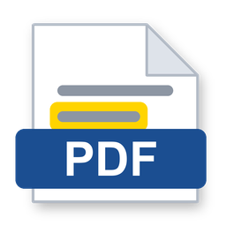

<p align="center"></p>

<h1 align="center">PikaPDF <sub>(앱 화면에는 "PDF 뷰어"로 표시)</sub></h1>

**Windows용 가볍고 빠른 PDF 뷰어·주석 도구. 아크로뱃 리더처럼 보고, 형광펜·메모·서명을 남기고, 페이지를 정리하고, 변환까지.**
Firefox의 PDF 엔진(PDF.js)을 Windows 내장 WebView2 창에 올린 단독 실행 프로그램입니다. 설치 프로그램 없이 폴더 하나로 동작합니다.

> Free and open source (GPLv3, with a WebView2 linking exception). 계정 없음, 추적 없음, 광고 없음.
> 같은 제작자의 XPS 피팅 프로그램 [PikaXPS](https://taeheekim2024-star.github.io/pikaxps/)와 한 식구입니다.

## 되는 것

| | |
|---|---|
| 보기 | 탭 여러 개, 검색, 목차·썸네일, 두 쪽 보기, 프레젠테이션, 한글 PDF 완벽 지원 |
| 주석 | 형광펜(여러 색), 자유 그리기, 텍스트 메모, 이미지 넣기, 서명, 댓글, 양식 입력 |
| 저장 | Ctrl+S로 원본에 바로 저장(직전 원본은 자동 백업), 다른 이름으로 저장, 인쇄 |
| 페이지 | 삭제·잘라내기·복사·추출·순서 바꾸기, 다른 PDF나 이미지 합치기, 회전 저장(주석 유지) |
| 도구 | 용량 줄이기·잠금 해제(PDF24의 Ghostscript), 이미지 추출, PDF→이미지/텍스트/Word, 오피스·한글 문서→PDF |
| 성능 | 더블클릭에서 첫 화면까지 약 1초, 이미 떠 있는 창에 새 탭은 0.1초대 |

안 되는 것: 본문 글자 자체를 고치는 편집(Acrobat Pro 영역), PDF→엑셀/파워포인트, OCR.

## 설치

1. [Releases](https://github.com/taeheekim2024-star/pikapdf/releases)에서 `PikaPDF-Windows-x64.zip`을 받아 원하는 폴더에 풉니다(예: `문서\PDF뷰어`).
2. 폴더의 `등록.ps1`을 PowerShell로 실행하면 "연결 프로그램" 목록과 시작 메뉴·바탕화면 바로가기가 생깁니다.
3. PDF 우클릭 → 연결 프로그램 → 다른 앱 선택 → "PDF 뷰어" → 항상.

요구 사항: Windows 10/11 (64비트), WebView2 런타임(Windows 11 기본 포함). 용량 줄이기·잠금 해제는 [PDF24 Creator](https://tools.pdf24.org/)가 설치되어 있을 때, 변환은 Microsoft Office·한컴오피스가 있을 때 동작합니다.

자세한 사용법은 [README.txt](README.txt)를 보세요.

## 직접 빌드

Windows에 기본 포함된 .NET Framework C# 컴파일러만 씁니다(Visual Studio 불필요).

```powershell
powershell -ExecutionPolicy Bypass -File .\setup.ps1    # pdf.js 배포본·WebView2 SDK 내려받고 패치 적용
powershell -ExecutionPolicy Bypass -File .\src\build.ps1 # PdfViewer.exe 생성
.\PdfViewer.exe --selftest .\out .\sample.pdf             # 자체 시험 (선택)
```

`setup.ps1`은 Python 3이 필요합니다(패치 적용용; Windows의 `python` 또는 WSL의 `python3`).

## 구조

```
src/Program.cs      WinForms 호스트: 탭·헤더·메뉴, 파일 제공(/doc)·저장(/save)·내보내기(/export), 도구, 자체 시험
inject.js           PDF.js 뷰어에 주입되는 스크립트: 저장 가로채기, 수정 감지, 단축키, 이미지·텍스트 내보내기
start/              빈 탭의 시작 화면 (최근 문서, 공지)
src/patch_pdfjs.py  pdf.js 증분 저장에 "페이지 회전" 변경을 끼워 넣는 패치
docs/               GitHub Pages 소개 페이지와 notice.json
```

## 라이선스와 이름

- 코드: [GPL-3.0](LICENSE). [NOTICE](NOTICE)에 적힌 GPLv3 §7 추가 조건이 함께 적용됩니다 —
  파생작은 "Based on PikaPDF" 출처 표기를 유지해야 하고, Microsoft WebView2 SDK/런타임과 함께 배포하는 것이
  명시적으로 허용됩니다(연결 예외).
- 이름과 아이콘: [TRADEMARK.md](TRADEMARK.md). GPL은 코드에만 적용되며 프로젝트 이름·마스코트·아이콘은 제작자의 표장입니다.
  포크는 다른 이름과 아이콘을 써야 합니다.
- 상업 이용: [COMMERCIAL-LICENSE.md](COMMERCIAL-LICENSE.md). 학술·비상업 이용은 영원히 무료입니다.
- 제3자 구성 요소: [THIRD-PARTY-LICENSES.txt](THIRD-PARTY-LICENSES.txt) (PDF.js Apache-2.0, WebView2 SDK 등).

## 개인정보

계정·원격 측정·광고가 없습니다. 네트워크 요청은 시작할 때 프로젝트 사이트의 정적 파일 하나
(`docs/notice.json`)를 읽는 것뿐이며, 새 버전이나 공지를 알리는 용도입니다. 보내는 정보는 없고,
도움말 메뉴의 "시작할 때 프로젝트 공지 받기"를 끄면 그 요청도 하지 않습니다.

---

## English

PikaPDF is a small, fast PDF viewer and annotator for Windows: tabs, highlights, notes, signatures,
page organizing (delete/extract/reorder/merge/rotate), compression and unlocking (via PDF24's
Ghostscript), image/text/Word export, and Office/Hangul-to-PDF conversion. It runs Mozilla's PDF.js
inside a WebView2 window; no installer, no account, no telemetry, no ads.

Build on any Windows machine with `setup.ps1` + `src\build.ps1` (only the C# compiler that ships
with .NET Framework is needed). Licensed under GPL-3.0 with the additional terms in `NOTICE`
(attribution must be kept; WebView2 linking exception); the name and icon are trademarks
(`TRADEMARK.md`); a commercial license can be arranged (`COMMERCIAL-LICENSE.md`).
